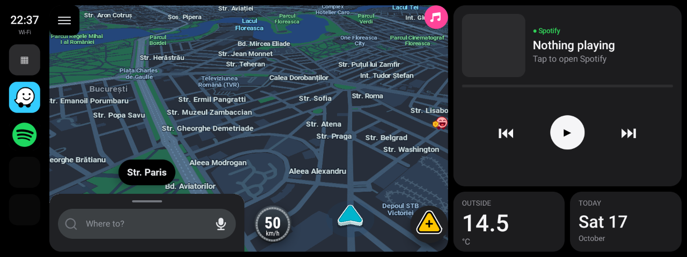

# DriveDeck

A CarPlay-style home screen for Android 9 head units, built for an **825X_Pro (AutoChips AC8257)** in a
BMW E90. Real apps run *inside* the dashboard: the actual Waze map in the main card, not a picture of it.



- **Dock:** clock, network, the unit's own launcher, Waze, and up to three music apps.
- **Map card:** Waze, embedded and touchable.
- **Now Playing:** Spotify, YouTube or YouTube Music, one at a time (picking one stops the other).
  For Spotify, the cover opens a library over the map, through Spotify's official App Remote SDK.
- **Outside:** the car's own outside-temperature sensor, read off CAN by the unit.
- **Today:** the date.

> **Do not operate it while driving.** Set things up while parked. This is a hobby project that runs
> with system permissions on your car's head unit; use it at your own risk.

## Status

Honest version, as of 18 Oct 2026:

- **On the head unit:** apps do run inside the dashboard's virtual displays. On the first run they were
  drawn at about half width; the correction (`vdfix`, see below) is built and checked offline, **not yet on
  the unit**. Neither are the fixes of 17 Oct (the dashboard getting covered, the map pausing).
- **On an Android 9 emulator set up like the unit** (1280×480 panel, `wm size 1920x720`, density 240,
  font scale 1.2), everything below works, and each fix has a script that fails without it.

## Will it run on my unit?

It needs a head unit whose firmware is signed with the public **AOSP test keys** and that supports
activities on secondary displays:

```sh
adb shell getprop ro.build.tags                                  # test-keys
adb shell pm list features | grep activities_on_secondary_displays
```

DriveDeck is signed with the same public test key, which gives it the signature permissions that
embedding needs (`ACTIVITY_EMBEDDING`, `INTERNAL_SYSTEM_WINDOW`, `MANAGE_ACTIVITY_STACKS`,
`INJECT_EVENTS`, ...). It has no `INTERNET` permission. The test key is not a secret (it ships with AOSP),
which is exactly why such firmware should not be trusted with anything sensitive.

Current Waze needs Android 10; on Android 9 use a 5.9.x build (5.9.5.4 works).

## Build

Needs the Android command-line tools (the scripts expect Homebrew's, build-tools 35, platform 34) and a
JDK. No Gradle.

1. Create an app in the [Spotify developer dashboard](https://developer.spotify.com/dashboard): redirect URI
   `drivedeck://spotify-auth`, Android package `dev.drivedeck`, and the SHA-1 of the AOSP test certificate,
   `27:19:6E:38:6B:87:5E:76:AD:F7:00:E7:EA:84:E4:C6:EE:E3:3D:FA`. Put its client ID (32 hex characters)
   in `spotify-client-id.txt`. No client secret is used.
2. `./build.sh`. It first runs `fetch-deps.sh`, which downloads Gson, the Spotify App Remote SDK and the
   AOSP test platform key, each checked against a pinned SHA-256, then checks the signing certificate of the
   APK it produced.

## Install

```sh
adb connect <unit-ip>:5555
adb install -r build/drivedeck.apk
adb shell cmd notification allow_listener dev.drivedeck/dev.drivedeck.DeckNotificationListener
```

Then press Home, pick **DriveDeck** and **Always**. That is required, not cosmetic: see "One resumed
activity" below. The dock's grid icon still opens the unit's own launcher.

Remove: `adb uninstall dev.drivedeck` (Home goes back to the unit's launcher).

## How it works

What makes embedding hard on this hardware, and what DriveDeck does about each:

- **Embedding.** The stock hidden `ActivityView` drew apps at half width on the unit. DriveDeck creates its
  own `VirtualDisplay`, renders it through a `TextureView` in its own window and forwards touches with the
  hidden `InputManager.createInputForwarder` (`EmbeddedDisplayView`).
- **Half width (`vdfix`).** On this unit each virtual display's image lands in a frame the size of the main
  display (1920×720), and that whole frame is stretched into the view. DriveDeck scales the texture back by
  1920/width and 720/height. On by default only on the `825X_Pro` model; `--ez vdfix true|false` overrides.
- **The vendor launcher coming over the dashboard.** A task started by a launcher has
  `NEW_TASK|TASK_ON_HOME`; Android 9 brings the Home stack to the front of the main display whenever such a
  task is started again or moved. DriveDeck moves an app's existing task instead of starting it, and puts
  itself back on top if anything came over it (`repro-return-home.sh`).
- **Cold starts escaping.** Started from cold, Waze opens its main screen by itself, with no display, so it
  lands full screen. For 20 s after starting an app, the slot brings it back whenever it leaves.
- **One resumed activity.** Android 9 resumes one activity at a time. A tap on the dashboard gives it the
  focus and pauses Waze, whose map then stops drawing (0 new frames while moving, `repro-map-pause.sh`).
  DriveDeck hands the focus back to the embedded app 300 ms later. If DriveDeck is not the Home app, doing
  that can bring the vendor launcher over the dashboard; DriveDeck detects it and keeps the focus instead,
  and the map pauses whenever you touch the dashboard. Hence "Always".
- **One dashboard.** Opening DriveDeck from its icon and then pressing Home creates a second instance
  (Android never reuses a standard activity for a Home launch). The newer one closes the older once it has
  the app in its slot.
- **Outside temperature.** The unit's own UI reads it off CAN and publishes it, formatted, in the system
  property `forfan.user.info` (the string its status bar shows). DriveDeck reads that property.
- **Text size.** The unit runs `font_scale=1.2`; the dashboard's text is sized in dp so its fixed layout
  does not clip. Embedded apps keep the system scale.

## Testing

Every fix above has a script that shows the failure on the old build and its absence on the new one:

| Script | What it checks |
|---|---|
| `car-verdict.sh` | Resumable session on the unit: embedding variants judged by `judge.py` from pixels, frame rate, temperature, media sessions. A capture where DriveDeck is not on top is INVALID, not FAIL. |
| `judge.py` | Measures how much of the slot the embedded app covers in a screenshot. |
| `repro-return-home.sh` | The vendor launcher must not end up over the dashboard. |
| `repro-map-pause.sh` | The Waze map must keep drawing after a tap on the dashboard (emulator: `geo fix`). |
| `fps-probe.sh`, `fps_stats.py` | Frame rate from SurfaceFlinger present times, the same way for DriveDeck and for CarPlay; runs detached on the unit. `fps_stats.py --selftest` checks the maths. |
| `connect.sh` | Finds the unit on a phone hotspot and keeps a Wi-Fi log on it across drops. |

`CAR-CHECKLIST.md` is the checklist for a session in the car, with the open questions and the evidence for
each fix. `docs/JOURNAL.md` is the dated development log.

## Related

[bmw-e90-android-headunit-825x](https://github.com/PanduruIonut/bmw-e90-android-headunit-825x): notes on this
head unit itself (reverse camera wiring, the hidden factory menu and its codes).

## License

Apache-2.0, see `LICENSE`. Downloaded at build time, not in this repository: Gson and the Spotify App Remote
SDK (both Apache-2.0) and the AOSP test platform key.

Not affiliated with Apple, BMW, Google, Spotify or Waze. CarPlay, Waze, Spotify, YouTube and BMW are
trademarks of their owners.
